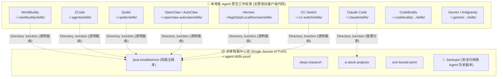

# skillctl - 本地多 Agent 技能统一扫描、中心化存储与路由管理工具

> **核心目标**：扫描本地所有 AI Agent 的技能库（690+ 技能），解决技能分散、版本不一致、重复占用磁盘的问题。
> **实现原理**：技能单一物理存储在 `~/.agent-skills-pool/`，通过 Windows 原生目录联接（`mklink /J`）透明路由到各个 Agent，**一处修改，所有 Agent 实时生效**。

---

## 🏛️ 整体架构设计



### 为什么选择目录联接（Directory Junction / Reparse Point）？
1. **对 Agent 完全透明**：Agent 依然从自己原生的本地文件夹读取技能，无需任何配置变更。
2. **免管理员权限**：Windows 原生支持普通用户直接建立目录联接，安全轻量。
3. **物理单一**：无论通过哪一个 Agent 或编辑器修改了技能脚本/Prompt，其他所有 Agent **实时看到修改，无需同步操作**。
4. **安全可逆**：转为联接前，原有独立副本全部安全自动归档到 `.backups/` 目录，随时可一键 `unlink` 恢复。

---

## 🚀 核心使用场景与操作指南

### 场景一：多 Agent 拥有同名副本，指定其中一个为主技能（Master）
> **场景**：`workbuddy`、`qoder`、`openclaw`、`zcode` 等都有 `java-troubleshoot`，但内容可能有差异，希望以 `workbuddy` 的版本为准，其它全部变为软链接。

```bash
# 一键指定 workbuddy 为主版本并建立所有 Agent 联接：
python skillctl.py set-master java-troubleshoot workbuddy

# 或等价写法：
python skillctl.py link java-troubleshoot --master workbuddy
```
**自动执行逻辑**：
- 提取 `workbuddy` 下的版本写入 `~/.agent-skills-pool/java-troubleshoot`。
- 将 `qoder`、`openclaw`、`hermes`、`cc-switch`、`zcode` 原有的独立副本**安全归档**至 `~/.agent-skills-pool/.backups/<agent>/`。
- 将这些 Agent 的原目录替换为指向中心池的 Junction 联接。

---

### 场景二：把某个 Agent 独有的技能快速分享给其他 Agent
> **场景**：`openclaw` 下有一个非常好用的 `a-stock-analysis`，想给 `claude` 和 `qoder` 也装上，但不想复制多份。

```bash
python skillctl.py link a-stock-analysis --also-to claude,qoder
```
`claude` 和 `qoder` 会直接获得指向中心池的路由联接，零冗余占用！

---

### 场景三：对比与查重不同 Agent 的同名技能
```bash
# 查看所有跨 Agent 重复/共享的技能清单
python skillctl.py shared

# 对比某个同名技能在各 Agent 中的文件数、体积大小、MD5 哈希差异
python skillctl.py diff java-troubleshoot
```

---

### 场景四：查看当前所有技能的路由状态
```bash
python skillctl.py status

# 或只看某个 Agent 的状态
python skillctl.py status --agent qoder
```
输出会清晰标记哪些技能已是软联接（`🔗`），哪些仍然是独立副本（`📁`）。

---

### 场景五：安全恢复与解除联接（无损回退）
如果你想把某个技能解绑恢复为独立的物理副本：
```bash
# 恢复所有拥有此技能的 Agent 为独立物理文件夹
python skillctl.py unlink java-troubleshoot

# 仅恢复指定 Agent 为独立副本
python skillctl.py unlink java-troubleshoot --agent claude
```

---

### 场景六：一键全量集中化
```bash
# 扫描所有 Agent，自动选取文件最全的版本存入中心池，全部转为联接
python skillctl.py centralize

# 仅对指定 Agent 无确认静默执行
python skillctl.py centralize --agents claude,qoder,workbuddy -y
```

---

## 📋 完整 CLI 命令速查表

| 命令 | 完整示例 | 作用说明 |
|---|---|---|
| `scan` | `python skillctl.py scan` | 一键扫描本地所有 10 类 Agent 的全部技能 |
| `status` | `python skillctl.py status` | 查看哪些技能已建立中心化路由联接 |
| `shared` | `python skillctl.py shared` | 列出跨 Agent 共有/冲突的技能列表 |
| `diff` | `python skillctl.py diff <技能名>` | 对比同名技能在不同 Agent 间的差异详情 |
| `set-master` | `python skillctl.py set-master <技能名> <主Agent>` | **以指定 Agent 为主技能写入共享池，其他全部转为联接** |
| `link` | `python skillctl.py link <技能名> [--master <Agent>] [--also-to <Agent列表>]` | 建立技能路由，可指定主版本或安装给新 Agent |
| `unlink` | `python skillctl.py unlink <技能名> [--agent <Agent>]` | 取消路由联接，恢复为独立物理目录 |
| `centralize` | `python skillctl.py centralize [--agents <列表>] [-y]` | 一键全量集中化所有技能 |
| `search` | `python skillctl.py search <关键词>` | 快速搜索包含关键词的技能 |
| `info` | `python skillctl.py info <技能名>` | 查看技能详情、元数据与完整文件树 |
| `list` | `python skillctl.py list [--agent <Agent>]` | 列出所有已扫描的技能 |
| `pool` | `python skillctl.py pool` | 查看共享池中收录的技能列表 |

---

## 🗂️ 支持扫描的本地 Agent 与路径对照表

| Agent 平台 | 扫描与安装根路径 | 规范与说明 |
|---|---|---|
| **WorkBuddy** | `~/.workbuddy/skills` | WorkBuddy 原生技能目录 |
| **ZCode** | `~/.agents/skills` & `~/.zcode/skills` | 遵循 ZCode 官方配置规范的标准 User Scope 路径 |
| **Qoder** | `~/.qoder/skills` & `~/.qoder/workbuddy-skills` | Qoder 自定义与兼容技能目录 |
| **OpenClaw** | `~/.openclaw-autoclaw/skills` | OpenClaw / AutoClaw 技能库 |
| **CodeBuddy** | `~/.codebuddy/skills-marketplace/skills` | CodeBuddy 技能市场与本地技能库 |
| **Gemini / Antigravity** | `~/.gemini/antigravity/builtin/skills` & `plugins` | Antigravity 插件与内置技能目录 |
| **Hermes** | `~/AppData/Local/hermes/skills` | Hermes 全量业务技能分类目录（支持多层子目录递归） |
| **Claude Code** | `~/.claude/skills` | Claude Code 官方技能目录 |
| **CC-Switch** | `~/.cc-switch/skills` | Claude Code Switcher 技能目录 |
| **Cline** | `~/.cline/skills` | Cline 技能扩展目录 |

---

## ❓ 常见问题与注意事项

### Q1: 运行命令时提示 `[WinError 5] 拒绝访问` 怎么办？
- **原因**：当某个 Agent（如 WorkBuddy 或 ZCode）当前处于运行状态时，其后台进程可能会监控（Watch）技能文件夹，导致 Windows 锁定该目录不允许重命名。
- **处理方式**：
  1. `skillctl` 会友好捕获此情况：主版本仍会安全复制到共享池，其他未运行的 Agent 依然会顺利转换为联接。
  2. 若想把该 Master 本地目录也彻底换为联接，**只需暂时关闭该 Agent 软件**，再次运行 `set-master` 或 `link` 即可。

### Q2: 转为联接后，之前的旧文件去哪了？会不会丢？
- **绝不会丢**。在建立联接前，所有原有的独立文件都会被自动归档到：
  `~/.agent-skills-pool/.backups/<agent>/<技能名>_<时间戳>/`
  如果后续想找回某个 Agent 过去写过的独立修改，可随时在 `.backups` 文件夹中找到。
